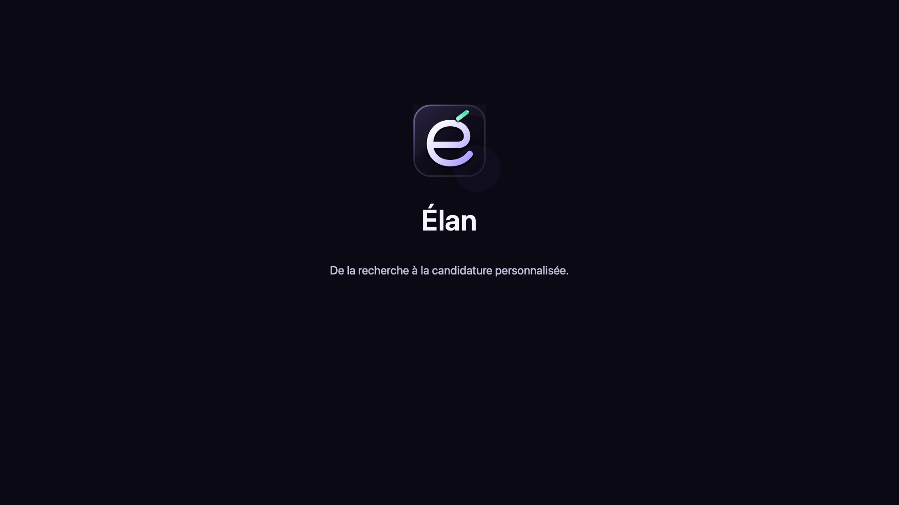

<p align="center">
  
</p>

<h1 align="center">Élan</h1>

<p align="center"><strong>De la recherche d’emploi à la candidature personnalisée, sur macOS.</strong></p>

<p align="center">
  <a href="#installation"></a>
  <a href="pyproject.toml"></a>
  <a href="https://github.com/lachtarnour/elan-career/actions/workflows/ci.yml"></a>
</p>

Élan rassemble les offres d’emploi, les compare à votre profil, prépare vos CV et lettres de motivation et conserve le suivi de vos candidatures. L’application associe une interface Qt Quick, une base SQLite locale et des pipelines Python pour passer d’une annonce à un dossier prêt à relire.

Le projet est conçu en priorité pour les profils **AI Engineer et métiers IA/data**, principalement de niveau junior à intermédiaire. Le profil, les recherches et certaines règles métier doivent être adaptés pour un autre domaine.

[**Voir la démonstration**](https://lachtarnour.github.io/elan-career/) · [Fonctionnalités](#fonctionnalités) · [Installation](#installation) · [Architecture](#architecture) · [Documentation](#documentation)

## Démonstration

[](https://lachtarnour.github.io/elan-career/)

[Ouvrir le lecteur](https://lachtarnour.github.io/elan-career/) · [Télécharger la vidéo originale](https://github.com/lachtarnour/elan-career/raw/refs/heads/main/artifacts/elan-demo.mp4)

## Fonctionnalités

| Espace | Ce que vous pouvez faire |
| --- | --- |
| **Recherche** | Rechercher sur plusieurs sources, choisir les critères de collecte et conserver l’origine des annonces. |
| **Doublons** | Comparer les annonces proches, confirmer les copies et garder la trace des décisions. |
| **Offres** | Filtrer, trier et sélectionner les offres ; consulter les analyses, le score IA, les points de correspondance et les risques. |
| **Analyse** | Lancer le préfiltre des missions, l’extraction et l’évaluation depuis les offres à analyser, en immédiat ou par Batch. |
| **Création des dossiers** | Adapter le CV, rédiger la lettre, consulter les points à vérifier et ouvrir les documents générés. |
| **Suivi** | Retrouver les parcours d’analyse et de génération, leur progression, les erreurs et les actions de reprise. |
| **Accueil** | Consulter les indicateurs, la courbe des candidatures envoyées et les candidatures récentes. |
| **Entreprises et Nouvelle offre** | Organiser les entreprises ciblées et ajouter une annonce par URL, texte ou formulaire. |
| **Profil et Réglages** | Gérer les données du candidat, les préférences, les connexions et la configuration des modèles IA. |

Les notes et les états des candidatures restent associés aux offres : **analysée**, **prête**, **envoyée**, **entretien** ou **archivée**. Le journal des traitements reste accessible dans **Suivi**, indépendamment de la sélection affichée dans Offres.

## Comment fonctionne une candidature

```text
Recherche ou ajout d’une offre
  → Normalisation et contrôle des doublons
  → Filtrage local
  → Préfiltre des missions → Extraction → Évaluation du profil
  → CV personnalisé → Lettre de motivation → Vérification
  → Relecture, envoi par l’utilisateur et suivi
```

1. **Collecter et dédoublonner.** Les connecteurs importent les annonces dans SQLite. Les copies certaines sont rattachées à leur offre principale ; les rapprochements incertains restent à examiner dans Doublons.
2. **Filtrer avant l’analyse.** Des règles locales vérifient les incompatibilités établies, notamment le métier, le contrat et l’expérience. Le préfiltre IA des missions écarte ensuite les offres clairement hors périmètre. Les décisions et leurs motifs sont conservés.
3. **Comprendre et prioriser.** L’extraction structure les faits de l’annonce. L’évaluation les compare au profil et attribue un **score IA global**, accompagné de raisons et de risques. Le score aide à choisir les offres ; il ne déclenche pas de rejet automatique.
4. **Préparer le dossier.** Élan sélectionne les éléments pertinents du profil, personnalise le CV, rédige la lettre et vérifie la cohérence des textes avec les sources fournies. Les descriptions d’expérience du CV restent celles du profil. Les remarques de contenu apparaissent parmi les points à vérifier dans **Prêt**.
5. **Relire et suivre.** Le CV est disponible en DOCX éditable et en HTML ; les PDF du CV et de la lettre dépendent du rendu disponible. L’utilisateur relit les documents, effectue l’envoi sur le site de recrutement et met à jour la candidature dans Élan.

Les analyses et les créations peuvent être lancées **en immédiat ou par Batch**. Les journaux et résultats intermédiaires permettent de suivre les étapes et de reprendre les traitements compatibles. Les lots déjà soumis continuent chez le fournisseur lorsque l’application est fermée ; les étapes locales reprennent à sa réouverture. Voir les guides [Analyse Batch](docs/batch-analysis.md) et [Création des candidatures](docs/batch-generation.md).

## Installation

Les instructions suivantes s’adressent aux personnes disposant d’une autorisation d’utilisation du code ; voir la [licence](LICENSE).

### Prérequis

- **macOS 13 ou ultérieur**.
- **Python 3.10 ou ultérieur** ; la CI utilise Python 3.11.
- Git et les outils de développement en ligne de commande nécessaires à `make`.
- Les identifiants des sources et fournisseurs que vous souhaitez utiliser.

### Installer depuis les sources

```bash
git clone https://github.com/lachtarnour/elan-career.git
cd elan-career
make install-desktop
```

Cette commande crée `.venv` et installe l’application, les dépendances de l’interface, du rendu PDF et du développement. Pour choisir une version précise de Python, utilisez par exemple `make install-desktop PY=python3.11`.

Créez ensuite la configuration locale et votre profil à partir de l’exemple fourni :

```bash
cp .env.example .env
mkdir -p smartapply/profile/data
cp smartapply/profile/mock_profile/*.json smartapply/profile/data/
```

Renseignez les fichiers du profil avec vos informations et configurez les fournisseurs dans `.env`. Le fichier `model_config.json` définit les modèles et paramètres par étape. Les chemins de base, de profil et de sortie sont configurables dans `.env`.

```bash
make run-desktop
```

Pour construire l’application macOS, après configuration et fermeture d’une éventuelle instance de `dist/Elan.app` :

```bash
make build
open dist/Elan.app
```

Le [guide de configuration](docs/setup.md) détaille le lancement depuis les sources, la copie d’un environnement de développement isolé depuis l’application installée, la synchronisation du profil et la construction du bundle.

## Sources et fournisseurs IA

Seuls les connecteurs que vous configurez sont nécessaires à vos recherches.

| Source | Configuration principale | Guide |
| --- | --- | --- |
| France Travail | `FRANCETRAVAIL_CLIENT_ID`, `FRANCETRAVAIL_CLIENT_SECRET` | [API France Travail](docs/sources/francetravail.md) |
| LinkedIn via Apify | `APIFY_TOKEN` et paramètres `LINKEDIN_*` | [Connecteur LinkedIn](docs/sources/linkedin.md) |
| Google Jobs via SerpApi | `SERPAPI_API_KEY` et paramètres `SERPAPI_*` | [Connecteur Google Jobs](docs/sources/serpapi.md) |
| Welcome to the Jungle | `WTTJ_COOKIE` selon le mode de collecte | [Connecteur WTTJ](docs/sources/welcometothejungle.md) |

Les étapes IA utilisent **OpenAI** ou **Anthropic**, avec les clés `OPENAI_API_KEY` et `ANTHROPIC_API_KEY`. Le fournisseur, le modèle, l’effort de raisonnement et le budget de sortie sont configurables par appel dans `model_config.json` et depuis les Réglages. Les recherches et traitements IA peuvent entraîner des frais auprès des services configurés ; le coût dépend de leur usage et de leurs tarifs.

Des fournisseurs IA simulés sont disponibles pour le développement sans clé IA. Ils ne remplacent pas les sources de recherche et n’empêchent pas leurs appels réseau. Voir [la configuration des fournisseurs](docs/setup.md#providers) et le [catalogue des appels IA](docs/llm-providers.md).

## Profil et personnalisation

Le [profil d’exemple](smartapply/profile/mock_profile/) décrit le format des fichiers JSON à renseigner : identité, préférences, compétences, expériences, projets, formation, langues et certificats. Le profil privé utilisé depuis les sources se trouve par défaut dans `smartapply/profile/data/`.

| À personnaliser | Emplacement |
| --- | --- |
| Informations et préférences du candidat | Fichiers JSON du profil privé ; chemin `PROFILE_DIR` |
| Familles de métiers et termes de recherche | [`smartapply/pipeline/ingest/role_families.py`](smartapply/pipeline/ingest/role_families.py) |
| Règles de filtrage | [`smartapply/filtering/`](smartapply/filtering/) et [guide des règles](docs/setup.md#matching-rules) |
| Mise en page HTML/PDF du CV | [`smartapply/cv/templates/cv.html.j2`](smartapply/cv/templates/cv.html.j2) |
| Présentation du DOCX et consignes de rédaction | `template_style.json` et `style_guide.json` dans le profil |

Changer de profil ne modifie pas les vocabulaires et règles codés pour le métier cible. Les analyses et documents déjà enregistrés restent des résultats historiques ; ils ne sont pas régénérés automatiquement après une modification du profil ou des modèles.

## Données et fonctionnement local

SQLite conserve les offres, les décisions de doublon et de filtre, les analyses, les candidatures et les journaux de traitement. Les documents générés sont enregistrés dans le répertoire de sortie configuré.

| Exécution | Emplacements par défaut |
| --- | --- |
| Depuis les sources | Configuration `.env`, base `data/smartapply.db`, profil `smartapply/profile/data/`, documents `data/output/` |
| Application macOS construite | Configuration et données sous `~/Library/Application Support/Elan/` |

L’interface et le stockage fonctionnent localement. Les connecteurs contactent leurs services externes ; les appels IA transmettent les données nécessaires à l’étape, dont des éléments de l’offre et du profil. Les identifiants, le profil privé, les bases et les documents de travail sont exclus du suivi Git par la configuration du dépôt.

Le premier build initialise le répertoire de l’application lorsqu’il n’existe pas encore. Les builds suivants préservent ses données ; les profils du dépôt et de l’application se [synchronisent explicitement](docs/setup.md#synchronize-the-project-and-app-profiles).

## Architecture

**Python** porte la logique métier et les pipelines. **PySide6 / Qt Quick / QML** assurent l’interface macOS. **SQLAlchemy et SQLite** gèrent la persistance ; **Jinja2**, **python-docx** et le rendu HTML/PDF produisent les documents.

```text
smartapply/
├── desktop/      Interface QML, pont Python et services de l’application
├── scrapers/     Connecteurs des sources d’offres
├── offers/       Normalisation des annonces
├── dedup/        Détection et revue des doublons
├── filtering/    Règles locales de filtrage
├── pipeline/     Collecte, analyse, génération et coordination Batch
├── jobsearch/    États des offres et suivi des candidatures
├── profile/      Chargement et validation du profil candidat
├── llm/          Fournisseurs, prompts et contrats des réponses IA
├── cv/           Adaptation, assemblage et rendu des documents
└── database/     Modèles, accès SQLite et journaux persistants
```

Les composants QML déclenchent les services Python ; les pipelines conservent leur progression dans la base. Les journaux d’analyse et de création sont distincts et réutilisent les transports IA configurés. Les responsabilités et les données de chaque étape sont détaillées dans le [parcours d’une offre](docs/parcours-offre.md).

## Développement et vérification

```bash
make check            # Ruff et tests hors intégration et appels LLM réels
make test             # Suite de tests
make lint             # Vérification du code
.venv/bin/elan --help  # Commandes de maintenance
```

Les tests de régression utilisent des données fictives, des fournisseurs simulés et un environnement temporaire. `make check` ne nécessite ni profil privé ni clé API. La CI s’exécute sur macOS avec Python 3.11 et vérifie également le contenu de la distribution Python.

Pour les changements d’interface, suivez les [conventions et vérifications visuelles](docs/desktop-design.md). Les responsabilités des modules, les attentes de validation et la préparation d’une modification sont décrites dans [CONTRIBUTING.md](CONTRIBUTING.md).

## Documentation

| Sujet | Guide |
| --- | --- |
| Installation, profil, configuration et build | [Configurer Élan](docs/setup.md) |
| Parcours complet d’une annonce | [Parcours d’une offre](docs/parcours-offre.md) |
| Sources de recherche | [Connecteurs](docs/sources/README.md) |
| Décisions de filtre et états affichés | [Filtrage et états](docs/filter-labels.md) |
| Comparaison et résolution des doublons | [Revue des doublons](docs/duplicate-review.md) |
| Analyse et reprise des lots | [Analyse Batch](docs/batch-analysis.md) |
| Génération, vérification et reprise des dossiers | [Création des candidatures](docs/batch-generation.md) |
| Paramètres des modèles et appels IA | [Fournisseurs IA](docs/llm-providers.md) |
| Gestion des sociétés ciblées | [Entreprises](docs/company-targeting.md) |
| Évolutions publiées | [Historique des versions](CHANGELOG.md) |

Consultez l’[index de la documentation](docs/README.md) pour les autres guides. Pour signaler un problème, ouvrez une [issue](https://github.com/lachtarnour/elan-career/issues) en indiquant les étapes de reproduction et les versions utilisées, sans joindre d’identifiants ni de données personnelles.

## Auteur et licence

Créé par [Lachtar Nour](https://github.com/lachtarnour).

Copyright © 2026 Lachtar Nour. Tous droits réservés. L’accès public au dépôt est destiné à la consultation, à la démonstration visuelle et à l’évaluation technique. Toute utilisation du code doit être explicitement autorisée par l’auteur ; consultez la [licence](LICENSE).
